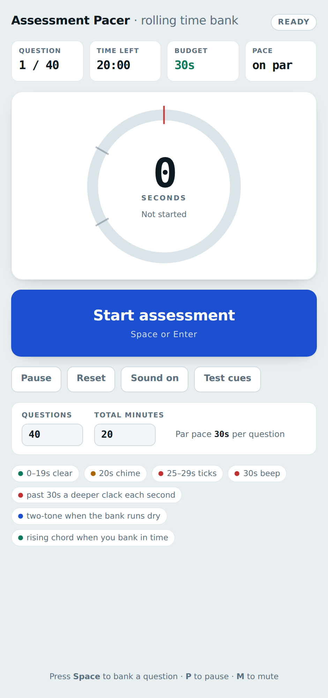
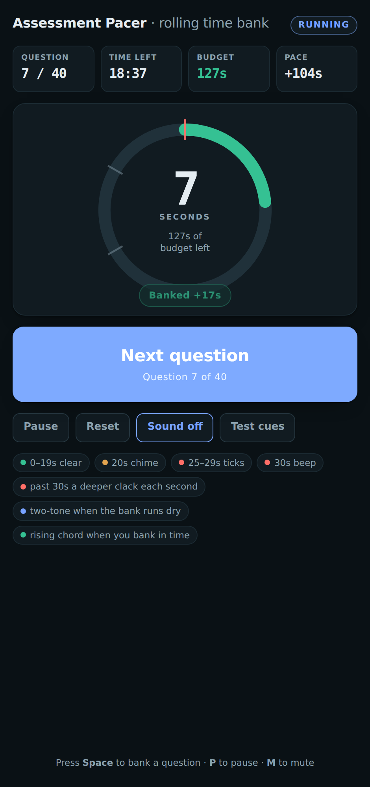
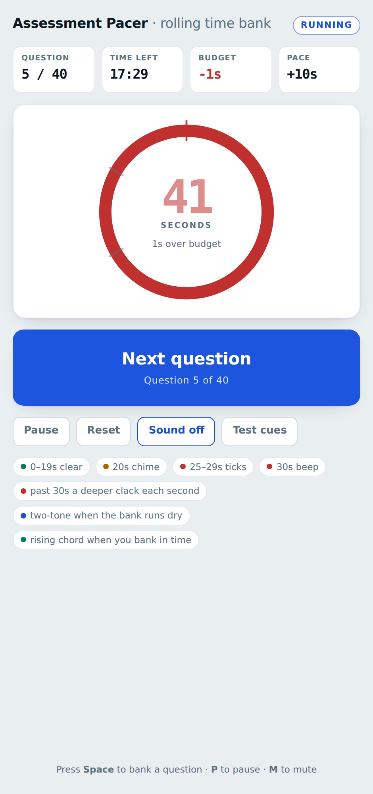
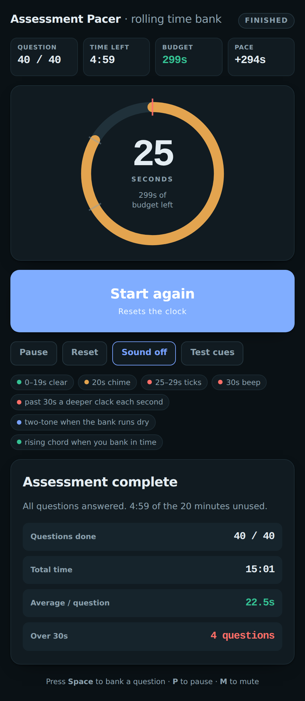

# Assessment Pacer

A single-page timer for sitting a timed multiple-choice assessment. It is built around one
idea: **time not spent on an easy question is not lost — it rolls forward to the hard ones.**

Defaults to 40 questions in 20 minutes (30 seconds par per question), and both numbers are
editable before you start.

<p align="center">
  
</p>

## The time bank

Every question opens with a budget of *all the time left, minus 30 seconds reserved for each
question still to come*:

```
budget = timeRemaining − (questionsAfterThisOne × 30s)
```

Answer question 1 in 5 seconds and question 2 opens with 55 seconds. Burn 90 seconds on
question 3 and you start question 4 already 30 seconds in deficit — the **Budget** tile goes
red and tells you so rather than quietly absorbing it.

| Tile | What it tells you |
| --- | --- |
| Question | Where you are in the paper |
| Time left | Clock on the whole assessment |
| Budget | Seconds still available on *this* question — negative means you are eating into later ones |
| Pace | How far ahead or behind par you started this question |

<p align="center">
  
</p>

## Audio cues

Cues fire at fixed marks on every question, so they work as a metronome regardless of how
much you have banked. Sound is unlocked by your first click — browsers require an
interaction before audio can play — and **Test cues** plays the whole set so you can set your
volume beforehand.

| When | Sound |
| --- | --- |
| 0–19s | Silence |
| 20s | Soft two-note chime |
| 25–29s | One dry click per second |
| 30s | Double beep |
| Past 30s | A deeper sawtooth clack **every second**, dropping in pitch and creeping louder the longer you stall, plus a beep at each further half-minute |
| Bank runs dry | A distinct descending two-tone — separate from the 30s beep, and suppressed when the two would collide |
| Banked in time | A rising chord: three notes under 20s, two notes between 20s and 30s |

<p align="center">
  
</p>

## Using it

- **The big button** banks the current question and opens the next one.
- <kbd>Space</kbd> or <kbd>Enter</kbd> does the same, which is what you want mid-paper.
- <kbd>P</kbd> pauses, <kbd>M</kbd> mutes.
- **Reset** asks for a second press while a run is in progress, so you cannot lose a paper to a stray click.

At the end you get a summary: questions completed, total time, average per question, and how
many questions went over the 30-second line.

<p align="center">
  
</p>

## Running it

No build step, no dependencies, no network calls beyond the webfont. Open `index.html` in a
browser, or serve the folder:

```sh
python3 -m http.server 8000   # then visit http://localhost:8000
```

A GitHub Actions workflow publishes the same file to GitHub Pages on every push to `main`.

## How it is built

One file. Vanilla HTML, CSS and JavaScript — no framework, no audio assets. Every sound is
synthesised at runtime with the Web Audio API, so there is nothing to download and nothing to
go missing.

Timing runs off `performance.now()` accumulated in a `requestAnimationFrame` loop rather than
`setInterval`, so it does not drift, and cues are keyed to whole seconds of question time so
each one fires exactly once.

Light and dark themes are both defined at the token level and follow your system setting.

## Licence

MIT — see [LICENSE](LICENSE).
